# Pontual — Grade, Ponto e Diário de classe

Aplicativo para professores organizarem a grade de aulas, lembrarem de bater o ponto e **prepararem o livro diário** (número da aula, data, conteúdo ministrado e observações) para depois lançar nos sistemas das instituições.

**Acesse:** <https://pontualprof.vercel.app/>

- Não precisa criar conta nem instalar nada da loja: abre no navegador e pode ser instalado na tela inicial.
- Seus dados ficam **no seu aparelho** (não vão para nenhum servidor). Faça backups — veja o [capítulo 11](#11-backup-e-segurança-dos-dados).
- O Pontual **não registra o ponto por você**: ele abre o portal da sua instituição na hora certa e anota que você foi lá.

> **Sobre os prints deste guia:** usam dados fictícios (professora "Marina Duarte", "Universidade Federal Exemplo"). Os **círculos vermelhos numerados** nas imagens correspondem às listas logo abaixo de cada print.

---

## Índice

**Para quem usa**

1. [Instalar no celular ou computador](#1-instalar-no-celular-ou-computador)
2. [Primeiros passos (5 minutos)](#2-primeiros-passos-5-minutos)
3. [Cadastrar a grade de aulas](#3-cadastrar-a-grade-de-aulas)
4. [Registrar o ponto](#4-registrar-o-ponto)
5. [Diário de classe (passo a passo)](#5-diário-de-classe-passo-a-passo)
6. [Plano de ensino: previsto × realizado](#6-plano-de-ensino-previsto--realizado)
7. [Avaliações: provas, trabalhos e entregas](#7-avaliações-provas-trabalhos-e-entregas)
8. [Levar o diário para o sistema da instituição](#8-levar-o-diário-para-o-sistema-da-instituição)
9. [Lembretes e agenda do celular](#9-lembretes-e-agenda-do-celular)
10. [Vários semestres](#10-vários-semestres)
11. [Backup e segurança dos dados](#11-backup-e-segurança-dos-dados)
12. [Trocar de aparelho](#12-trocar-de-aparelho)
13. [Problemas comuns](#13-problemas-comuns)
14. [Perguntas frequentes](#14-perguntas-frequentes)

**Para quem mantém o código**

15. [Executar localmente](#15-executar-localmente)
16. [Testes](#16-testes)
17. [Publicar na Vercel](#17-publicar-na-vercel)
18. [Estrutura do projeto](#18-estrutura-do-projeto)

---

# Guia do professor

## O app em um minuto

O menu tem cinco telas:

| Tela | Para que serve |
|---|---|
| **Ponto** | Início. Mostra a aula de hoje, o relógio, as janelas de ponto, o botão que abre o portal da instituição e os alertas (ponto esquecido, diário pendente, avaliações, backup). |
| **Grade** | Todas as suas aulas da semana, em lista ou em quadro semanal, com carga horária e aviso de choque de horários. |
| **Diário** | Três abas: **Diário** (a tabela do livro diário), **Plano de ensino** (tópicos previstos × dados) e **Avaliações** (provas, trabalhos, entregas). |
| **Ajustes** | Perfil, instituições, links de ponto, tema (claro/escuro), lembretes, calendário, frases do diário e semestres. |
| **Dados** | Backup, importação de planilha de aulas, histórico de ponto e proteção do armazenamento. |

No computador o menu fica no topo; no celular, embaixo.

---

## 1. Instalar no celular ou computador

Instalar é opcional, mas **recomendado**: o app abre em tela cheia, funciona sem internet depois de carregado, e os dados ficam mais protegidos contra limpeza automática do navegador.

**Android (Chrome)**
1. Abra <https://pontualprof.vercel.app/>.
2. Toque nos três pontinhos **⋮** → **Instalar app** (ou **Adicionar à tela inicial**).

**iPhone / iPad (Safari)**
1. Abra o endereço no **Safari** (o passo abaixo não existe em outros navegadores).
2. Toque em **Compartilhar** (quadrado com seta) → **Adicionar à Tela de Início** → **Adicionar**.

**Computador (Chrome ou Edge)**
1. Abra o endereço.
2. Clique no ícone de instalar, no canto direito da barra de endereço (ou menu **⋮** → **Instalar Pontual**).

> No iPhone, instalar na tela inicial é especialmente importante: o Safari pode apagar dados de sites que ficam muito tempo sem uso, e um app instalado tem tratamento melhor.

Depois de instalado, em alguns aparelhos Android, segurar o ícone do app mostra **atalhos** para **Ponto**, **Diário de classe** e **Grade**.

---

## 2. Primeiros passos (5 minutos)

Na primeira vez, a tela **Ponto** mostra o cartão **“Configure o Pontual em 3 passos”**. Siga na ordem:

### Passo 1 — Seu perfil (opcional)
**Ajustes → Perfil docente**: preencha **Nome** e **Vínculo / cargo** e toque em **Salvar perfil**. Dá para **Trocar foto**. O nome aparece na Home e no cabeçalho do diário impresso.

### Passo 2 — Cadastre a instituição e o link do ponto
**Ajustes → Instituições**:

<p align="center">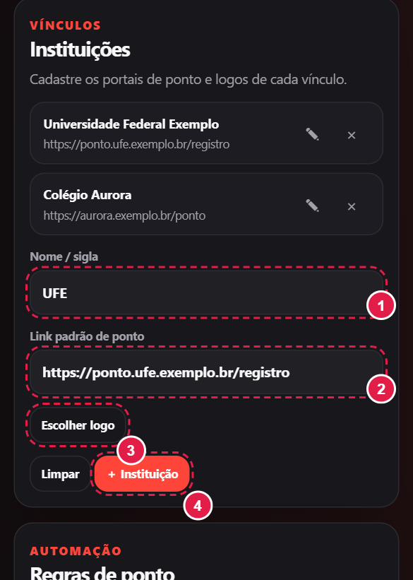</p>

1. **Nome / sigla**: por exemplo `UFE` ou `Colégio Central`.
2. **Link padrão de ponto**: o endereço do portal onde você bate o ponto. Copie do navegador, começando por `https://`.
3. **Escolher logo** (opcional): uma imagem de até 2 MB.
4. **+ Instituição**: salva.

Dá para cadastrar várias instituições. Para editar, use o lápis ✎ da lista; para remover, o ×.

### Passo 3 — Cadastre as aulas
Veja o [capítulo 3](#3-cadastrar-a-grade-de-aulas). Quando as três etapas estiverem completas, o cartão de boas-vindas some sozinho.

### Opcional: regras de ponto por dia e turno
Se a mesma instituição usa links diferentes (por exemplo, um para o turno da noite), vá em **Ajustes → Regras de ponto**:

<p align="center">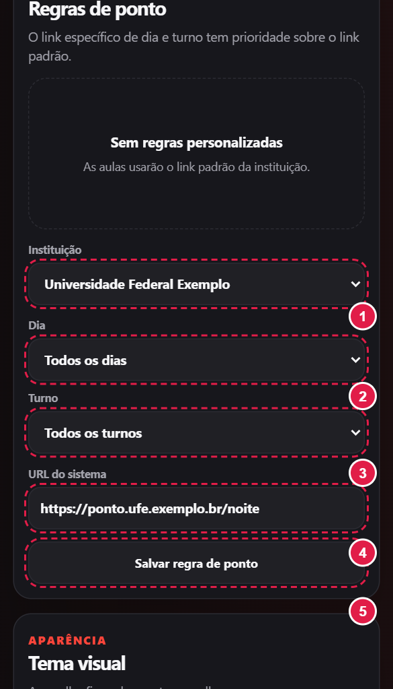</p>

1. **Instituição** a que a regra se aplica.
2. **Dia**: um dia da semana ou “Todos os dias”.
3. **Turno**: um turno ou “Todos os turnos”.
4. **URL do sistema**: o link para esse dia/turno.
5. **Salvar regra de ponto**.

O app escolhe o link nesta ordem de prioridade:
1. regra com o **dia e o turno** da aula;
2. regra só do **turno** (todos os dias);
3. regra só do **dia** (todos os turnos);
4. o **link padrão** da instituição.

### Opcional: tema (claro, escuro, rubro e ouro)
**Ajustes → Aparência → Tema visual**. A escolha fica salva neste aparelho.

<p align="center">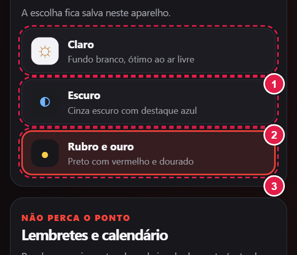</p>

1. **Claro** — fundo branco, bom ao ar livre.
2. **Escuro** — cinza escuro com destaque azul.
3. **Rubro e ouro** — preto com vermelho e dourado (padrão).

---

## 3. Cadastrar a grade de aulas

### Uma aula por vez
**Grade → + Aula** (ou **Ponto → + Aula**):

<p align="center">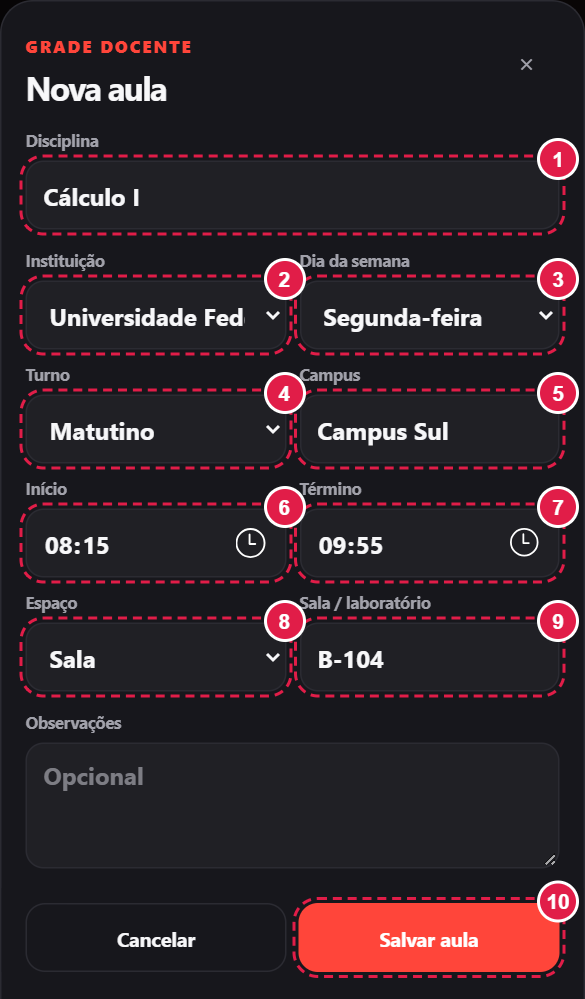</p>

1. **Disciplina**: nome da disciplina. Use **sempre o mesmo nome** nas aulas da mesma turma: é ele que junta os dias da semana no mesmo diário.
2. **Instituição**: uma das instituições cadastradas.
3. **Dia da semana**: dia em que a aula acontece.
4. **Turno**: Matutino, Especial, Vespertino ou Noturno.
5. **Campus**: unidade/campus.
6. **Início** e 7. **Término**: horário da aula, por exemplo `08:15` e `09:55`.
8. **Espaço**: Sala ou Laboratório.
9. **Sala / laboratório**: o número ou identificação.
10. **Salvar aula**. (O campo **Observações** é opcional.)

Uma disciplina que acontece em dois dias (ex.: segunda e quarta) vira **duas aulas** com o mesmo nome.

> Se duas aulas se sobrepõem no mesmo dia, o app avisa ao salvar e marca **Conflito de horário** na Grade. É só um aviso: você pode manter assim.

### Várias aulas de uma vez: planilha
Em **Dados → Planilha de aulas**:

<p align="center">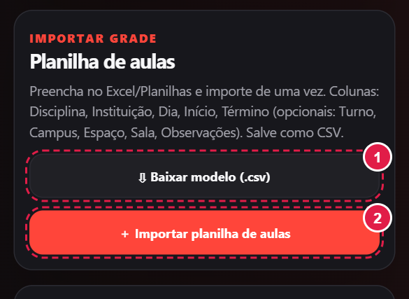</p>

1. **Baixar modelo (.csv)**: abra no Excel ou Planilhas Google, preencha uma aula por linha e salve como **CSV**.
2. **Importar planilha de aulas**: escolha o arquivo.

Colunas obrigatórias: **Disciplina, Dia, Início, Término**. Opcionais: **Instituição, Turno, Campus, Espaço, Sala, Observações**.

```text
Disciplina;Instituição;Dia;Início;Término;Turno;Campus;Espaço;Sala;Observações
Cálculo I;UFE;Segunda;08:15;09:55;Matutino;Campus Sul;Sala;B-104;
Banco de Dados;UFE;Quarta;19:00;20:40;Noturno;Campus Sul;Laboratório;L-02;Levar notebook
```

- O **Dia** aceita `Segunda`, `Terça`, `seg`, `qua`… (com ou sem acento) ou o número de 0 (domingo) a 6 (sábado).
- Horários como `8:15`, `08:15` ou `8h15`.
- Instituições que ainda não existem são criadas automaticamente. **Depois, informe o link de ponto delas em Ajustes.**
- Linhas com erro são ignoradas e o app mostra o motivo antes de importar.

### Conferir a grade
<p align="center">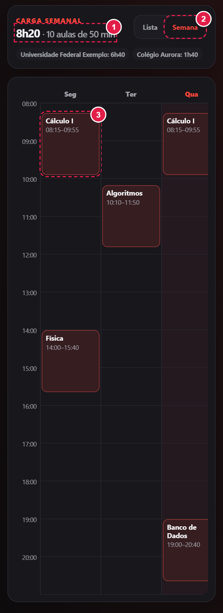</p>

1. **Carga semanal**: total de horas e de aulas de 50 min, com o total por instituição.
2. **Lista | Semana**: alterna entre as aulas agrupadas por dia (com ✎ editar e × excluir) e o quadro semanal.
3. **Bloco de aula**: toque para editar. Aulas que se sobrepõem aparecem em vermelho, lado a lado.

---

## 4. Registrar o ponto

Na tela **Ponto** o app mostra a aula de hoje (ou do dia escolhido na faixa **Dom–Sáb**):

<p align="center">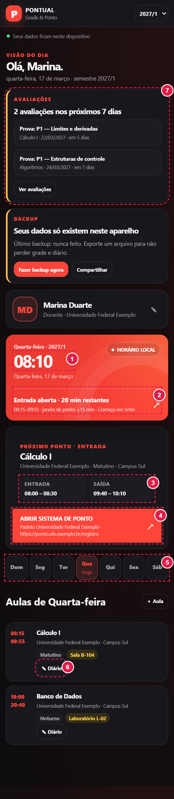</p>

1. **Relógio** do aparelho.
2. **Situação da janela de ponto** (“Entrada aberta · 20 min restantes”) e quanto falta para a aula começar ou terminar.
3. **Janelas de ponto**: de 15 minutos antes a 15 minutos depois do **início** (entrada) e do **término** (saída).
4. **ABRIR SISTEMA DE PONTO**: abre o portal da instituição em outra aba.
5. **Faixa de dias**: veja a aula de outro dia da semana.
6. **✎ Diário**: abre o registro daquela aula no diário (usa a data mais recente desse dia da semana).
7. **Cartões de alerta**: avaliações próximas, backup, ponto esquecido e diário pendente. Só aparecem quando há algo a fazer.

### Fluxo
1. Dentro da janela, toque em **ABRIR SISTEMA DE PONTO** e bata o ponto no portal, como sempre.
2. Volte ao Pontual. Ele pergunta **“Você concluiu o registro?”**:

<p align="center">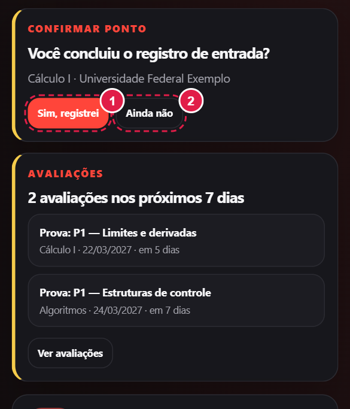</p>

   1. **Sim, registrei** → fica **confirmado** no histórico.
   2. **Ainda não** → o app continua te lembrando.

### Ponto esquecido
Se a janela de uma aula de hoje já fechou e não há registro confirmado, aparece o cartão **“Possível ponto esquecido hoje”** (e, se a aula já começou, o aviso de diário pendente):

<p align="center">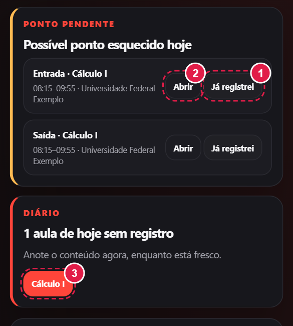</p>

1. **Já registrei**: anota que você fez (use se bateu o ponto fora do app).
2. **Abrir**: leva ao portal.
3. **Botão da disciplina** (no cartão de diário): abre o registro da aula de hoje.

### Histórico
**Dados → Batidas de ponto** lista tudo, com a situação (confirmado, não concluído, aguardando confirmação). **Exportar CSV** gera uma planilha para conferir com o RH.

> Não consegue abrir o portal? Veja [Problemas comuns](#13-problemas-comuns).

---

## 5. Diário de classe (passo a passo)

O diário é feito **por disciplina** (a mesma disciplina na mesma instituição, no semestre ativo). Abra **Diário**, aba **Diário**, e escolha a disciplina.

<p align="center">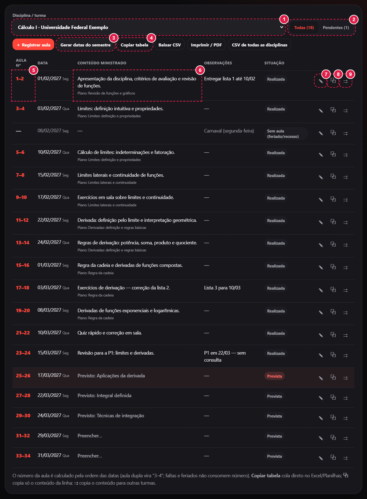</p>

1. **Disciplina / turma**: troca de disciplina.
2. **Todas | Pendentes**: o filtro **Pendentes** mostra só as aulas que já passaram e ainda estão sem conteúdo.
3. **Gerar datas do semestre**: cria as linhas de todas as aulas do período (veja o Caminho B).
4. **Copiar tabela**: copia tudo para colar no Excel, Planilhas ou outro sistema.
5. **Aula nº**: número calculado automaticamente.
6. **Conteúdo ministrado**: o que você registrou. Em letra pequena aparece o **Plano:** (tópico do plano de ensino). Em linhas ainda por preencher aparece “Previsto: …”.
7. **✎**: editar a aula.
8. **⧉**: copiar **só o conteúdo** da linha (para colar no campo do sistema da instituição).
9. **⇉**: copiar o conteúdo para **outras turmas**.

Também na barra: **Registrar aula**, **Baixar CSV**, **Imprimir / PDF** e **CSV de todas as disciplinas**.

### Como funciona a numeração
- O **número da aula** é calculado automaticamente pela **ordem das datas**.
- Aula com mais de um período no dia (ex.: 2 aulas de 50 min) usa **Aulas no dia = 2** e aparece como **“3–4”**. O app sugere esse valor pela duração da aula na grade (50 min por período); você pode mudar.
- **Falta do professor** e **Sem aula (feriado/recesso)** **não consomem número**.
- Se você inserir uma aula no meio ou mudar uma data, a numeração se ajusta sozinha.

### Situações de uma aula
| Situação | Quando usar | Conta no número? |
|---|---|---|
| **Realizada** | Aula normal dada | Sim |
| **Reposição** | Aula de reposição | Sim |
| **Prevista** | Gerada antes de acontecer | Sim (para visualizar) |
| **Falta do professor** | Você não pôde dar a aula | Não |
| **Sem aula (feriado/recesso)** | Feriado, recesso, evento | Não |

### O formulário “Registrar aula”

<p align="center">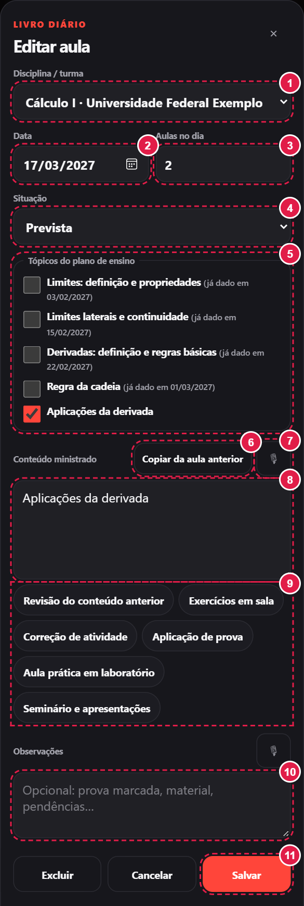</p>

1. **Disciplina / turma**.
2. **Data**.
3. **Aulas no dia**: quantos períodos (a numeração avança esse tanto).
4. **Situação**.
5. **Tópicos do plano de ensino** (só aparece se a disciplina tem plano): marque o que foi dado. Para aulas novas, o app já marca o **próximo tópico** e coloca o texto dele no conteúdo.
6. **Copiar da aula anterior**: traz o conteúdo (e as observações, se vazias) da aula anterior com conteúdo.
7. **🎙 Ditar por voz**: veja o [aviso de privacidade](#ditar-por-voz).
8. **Conteúdo ministrado**: o texto que vai para o livro diário.
9. **Frases frequentes**: toque para acrescentar ao conteúdo (veja como editá-las abaixo).
10. **Observações**: prova marcada, material, pendências…
11. **Salvar** (e **Excluir**, ao editar um registro existente).

### Caminho A — Preencher no dia (mais simples)
1. Depois da aula, na Home ou no topo do **Diário**, toque em **Registrar** na aula de hoje (ou, na lista de aulas da Home, no botão **✎ Diário**).
2. O formulário já vem com a disciplina, a data e as aulas do dia.
3. Escreva o **Conteúdo ministrado** (ou toque numa frase frequente) e, se quiser, as **Observações**.
4. Toque em **Salvar**.

### Caminho B — Gerar o semestre inteiro e ir preenchendo
1. No **Diário**, escolha a disciplina e toque em **Gerar datas do semestre**:

<p align="center">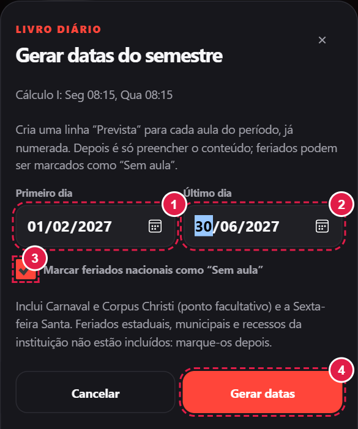</p>

   1. **Primeiro dia** e 2. **Último dia** do período letivo.
   3. **Marcar feriados nacionais como “Sem aula”** (marcado por padrão).
   4. **Gerar datas**.
2. O app cria uma linha **Prevista** para cada aula do período, já numerada.
3. **Feriados:** com a caixa marcada, os feriados nacionais já entram como **Sem aula** e o nome do feriado vai para as observações. Estão incluídos os fixos (Confraternização Universal, Tiradentes, Dia do Trabalho, Independência, N. Sra. Aparecida, Finados, Proclamação da República, Consciência Negra e Natal) e os móveis calculados pela Páscoa (**Sexta-feira Santa**, **Carnaval** segunda e terça, e **Corpus Christi**). Carnaval e Corpus Christi são **ponto facultativo**: confira se a sua instituição para nesses dias. **Feriados estaduais, municipais e recessos da instituição não estão incluídos**: marque-os à mão (✎ → Situação → **Sem aula (feriado/recesso)**); a numeração das seguintes se corrige.
4. A cada aula dada, abra a linha (✎), escreva o conteúdo e mude a situação para **Realizada**.

> Dica: use o filtro **Pendentes** para uma “faxina” semanal do diário. Linhas pendentes ficam destacadas.

### Copiar para outras turmas
Quando você dá o mesmo conteúdo em turmas diferentes (turmas paralelas), não precisa digitar de novo. Na linha da aula, toque em **⇉**:

<p align="center">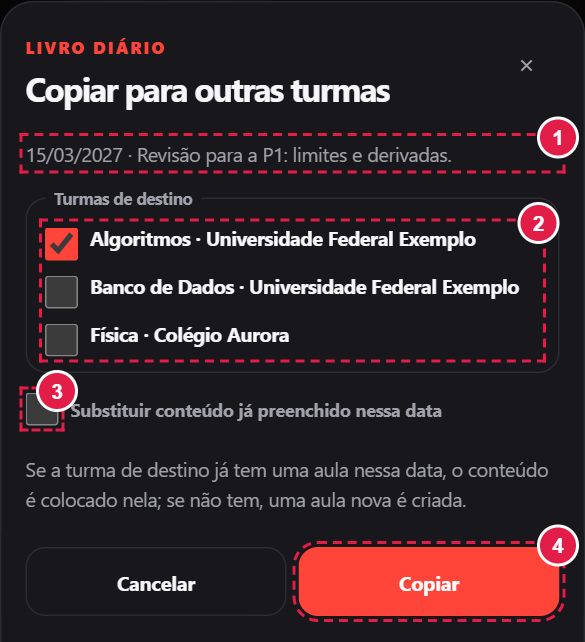</p>

1. **Resumo** do que será copiado (data e conteúdo).
2. **Turmas de destino**: marque uma ou mais. Cada turma é uma disciplina cadastrada na Grade (por exemplo, `Cálculo I - Turma A` e `Cálculo I - Turma B`, cadastradas com nomes diferentes).
3. **Substituir conteúdo já preenchido nessa data**: desmarcado, turmas que já têm conteúdo nessa data são **ignoradas**.
4. **Copiar**.

Se a turma de destino já tem uma aula nessa data, o conteúdo é colocado nela; se não tem, uma aula nova é criada na mesma data. O app informa quantas foram criadas, atualizadas e ignoradas.

### Frases frequentes
Textos que você repete muito (“Exercícios em sala”, “Aplicação de prova”…). Em **Ajustes → Frases frequentes** edite a lista (uma frase por linha, até 20) e toque em **Salvar frases**:

<p align="center">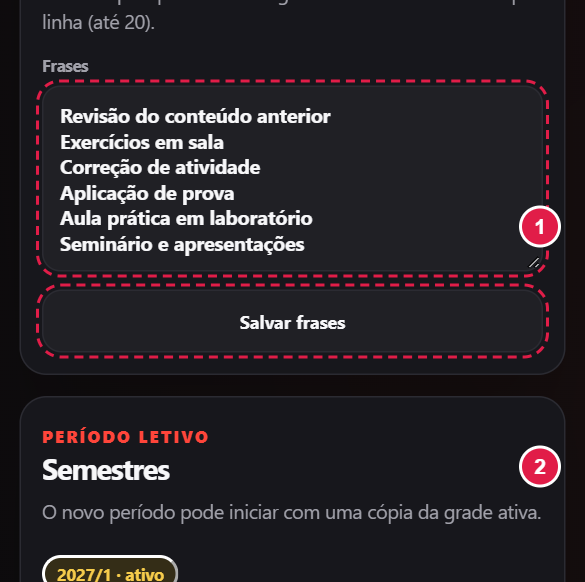</p>

1. **Frases**: uma por linha.
2. **Salvar frases**.

Elas aparecem como botões no formulário **Registrar aula**; ao tocar, a frase é acrescentada ao conteúdo.

### Ditar por voz
O botão **🎙** ao lado de **Conteúdo ministrado** e **Observações** transforma sua fala em texto (português do Brasil). Toque para começar e toque de novo para parar.

- Só aparece em navegadores que oferecem reconhecimento de voz (por exemplo, Chrome e Edge; no iPhone, Safari recente).
- **Privacidade:** o reconhecimento é feito pelo **navegador**, que pode enviar o áudio a servidores do fabricante (Google, Apple…). O Pontual não recebe esse áudio. Na primeira vez o app pede sua confirmação antes de usar.
- Precisa da permissão de microfone.

### Editar e excluir
Use ✎ na linha para editar. No formulário há **Excluir** para remover o registro.

### Regras úteis
- Não é possível criar duas aulas iguais na mesma data e horário; o app avisa.
- Se você renomear uma disciplina na Grade, o diário, o plano de ensino e as avaliações acompanham o novo nome (desde que o nome antigo não seja usado em outra aula).

---

## 6. Plano de ensino: previsto × realizado

Na aba **Plano de ensino** você cadastra a ementa da disciplina e acompanha quanto já foi dado.

<p align="center">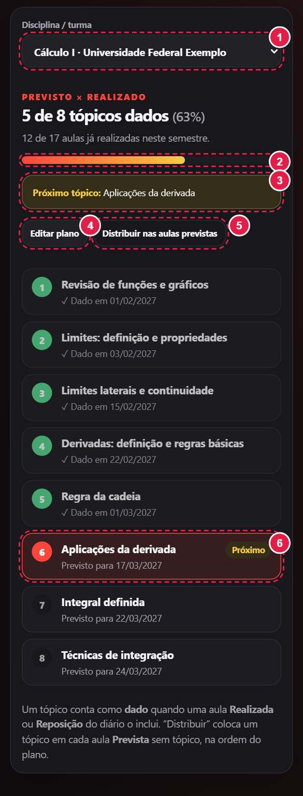</p>

1. **Disciplina / turma**: cada disciplina tem o seu plano.
2. **Barra de progresso**: tópicos dados ÷ total (a legenda mostra “5 de 8 tópicos dados (63%)” e quantas aulas já foram realizadas).
3. **Próximo tópico**: o primeiro que ainda não foi dado.
4. **Editar plano**: abre uma caixa onde você **cola a ementa, um tópico por linha** (numeração e marcadores são removidos; linhas repetidas são ignoradas). Se você corrigir o texto de um tópico, ele passa a ser tratado como tópico novo.
5. **Distribuir nas aulas previstas**: coloca um tópico, na ordem do plano, em cada aula **Prevista** que ainda não tem tópico (use depois de **Gerar datas do semestre**). Nas linhas do diário aparece “Previsto: …”.
6. **Lista de tópicos**: cada um mostra **✓ Dado em …**, **Previsto para …** ou **Pendente**; o próximo é destacado.

**Como um tópico vira “dado”:** quando uma aula **Realizada** ou **Reposição** do diário o inclui (caixa de **Tópicos do plano de ensino** no formulário). Aulas “Prevista”, “Falta” ou “Sem aula” não contam.

---

## 7. Avaliações: provas, trabalhos e entregas

Na aba **Avaliações** você agenda as datas e recebe lembretes.

<p align="center">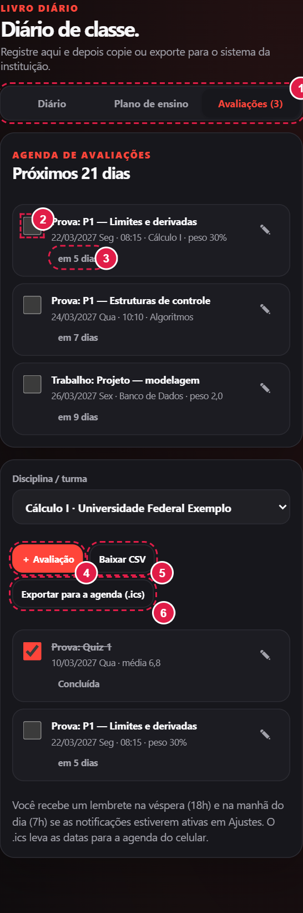</p>

1. **Abas** Diário | Plano de ensino | Avaliações. O número entre parênteses é a quantidade de avaliações pendentes nos próximos 14 dias.
2. **Caixa de seleção**: marca como **concluída** (realizada/entregue). Concluídas saem das listas de próximas e dos lembretes.
3. **Quando**: “hoje”, “amanhã”, “em 5 dias”… (em vermelho se já passou e não foi concluída).
4. **+ Avaliação**: cadastra uma nova.
5. **Baixar CSV**: planilha de todas as avaliações do semestre.
6. **Exportar para a agenda (.ics)**: leva as datas (pendentes) para a agenda do celular, com alarme.

O primeiro cartão (“Próximos 21 dias”) reúne as avaliações de **todas as disciplinas**; o segundo, as da disciplina escolhida. Na tela **Ponto** aparece o alerta **“N avaliações nos próximos 7 dias”**.

### Cadastrar uma avaliação

<p align="center">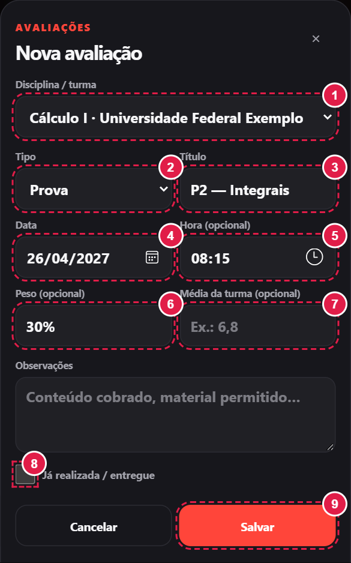</p>

1. **Disciplina / turma**.
2. **Tipo**: Prova, Trabalho, Entrega, Seminário ou Outro.
3. **Título**: por exemplo, “P1 — Limites”.
4. **Data**.
5. **Hora** (opcional).
6. **Peso** (opcional): texto livre, como `30%` ou `3,0`.
7. **Média da turma** (opcional): para anotar o resultado depois.
8. **Já realizada / entregue**.
9. **Salvar** (e **Excluir**, ao editar).

> O Pontual guarda as **datas e a média da turma**; ele não é um diário de notas por aluno.

**Lembretes:** com as notificações ativas, você é avisado **na véspera às 18h** e **na manhã do dia às 7h** (veja o [capítulo 9](#9-lembretes-e-agenda-do-celular)).

---

## 8. Levar o diário para o sistema da instituição

A aba **Diário** tem botões para cada jeito de trabalho:

| Botão | O que faz | Quando usar |
|---|---|---|
| **Copiar tabela** | Copia a tabela (com cabeçalho) separada por tabulação | Colar direto no **Excel / Planilhas Google**; alguns sistemas aceitam colar tabela |
| **⧉** (em cada linha) | Copia **só o conteúdo** daquela aula | Colar no campo “conteúdo” do sistema da instituição, aula por aula |
| **⇉** (em cada linha) | Copia o conteúdo para **outras turmas** | Turmas paralelas com o mesmo conteúdo |
| **Baixar CSV** | Baixa a tabela da disciplina | Guardar, enviar à coordenação, abrir no Excel (acentos corretos) |
| **CSV de todas as disciplinas** | Uma planilha com todas as turmas do semestre | Prestação de contas geral |
| **Imprimir / PDF** | Abre a impressão só com a tabela | Imprimir ou **Salvar como PDF** |

Colunas exportadas: **Nº da aula; Data; Conteúdo ministrado; Observações; Situação** (e, no CSV geral, também **Disciplina** e **Instituição**). O texto do plano de ensino não entra na exportação.

Exemplo de CSV:

```text
Nº da aula;Data;Conteúdo ministrado;Observações;Situação
1–2;01/02/2027;Apresentação da disciplina e revisão de funções;Entregar lista 1 até 10/02;Realizada
3–4;03/02/2027;Limites: definição intuitiva e propriedades;;Realizada
—;08/02/2027;;Carnaval (segunda-feira);Sem aula (feriado/recesso)
5–6;10/02/2027;Cálculo de limites: indeterminações e fatoração;;Realizada
```

> **Excel em português**: o CSV usa ponto e vírgula e codificação UTF-8 com BOM, então abre com colunas separadas e acentos corretos ao dar duplo clique. No Planilhas Google, use **Arquivo → Importar** e escolha o separador **Ponto e vírgula**.

---

## 9. Lembretes e agenda do celular

Em **Ajustes → Lembretes e calendário**:

<p align="center">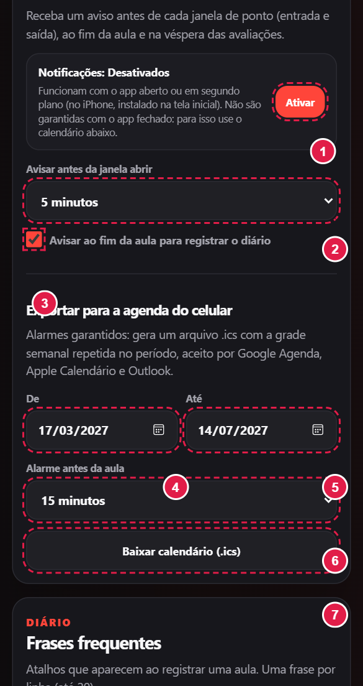</p>

1. **Ativar / Desativar** as notificações (o navegador pede permissão).
2. **Avisar antes da janela abrir**: 5, 10 ou 15 minutos.
3. **Avisar ao fim da aula para registrar o diário** (marcado por padrão): 5 minutos depois do término da aula você recebe “Aula terminou — registre o conteúdo”. Se você já preencheu o diário daquela aula, o aviso não é mostrado.
4. **De** e 5. **Até**: período do semestre para a agenda.
6. **Alarme antes da aula** na agenda: 10, 15, 30 ou 60 minutos.
7. **Baixar calendário (.ics)**.

### Quais avisos você recebe
- **Ponto:** antes da janela de entrada e da de saída.
- **Diário:** ao fim de cada aula (se ligado).
- **Avaliações:** na véspera às 18h e na manhã do dia às 7h.

Tocar na notificação abre o Pontual na tela correspondente.

**Limites (importante):** são notificações locais, geradas pelo navegador.
- Funcionam com o app **aberto ou em segundo plano**, e podem deixar de chegar se o sistema encerrar o app para economizar bateria. **Não conte com elas com o app fechado.**
- No iPhone, só funcionam com o app **instalado na tela inicial**.
- Se você bloqueou as notificações, o botão fica desativado: libere nas configurações do navegador/aparelho.

### Alarmes garantidos: agenda do celular (.ics)
É a forma confiável de ser avisado. Sua agenda dispara o alarme mesmo com o Pontual fechado.
1. Preencha **De**, **Até** e o **Alarme antes da aula**.
2. Toque em **Baixar calendário (.ics)** e abra o arquivo: o Google Agenda, o Calendário da Apple ou o Outlook adicionam todas as aulas, repetindo toda semana, com alarme.
3. As **avaliações** têm o próprio botão (**Exportar para a agenda (.ics)**) na aba **Avaliações**.

> Se você mudar a grade depois, exporte e importe novamente. Para evitar duplicatas, apague na agenda o calendário antigo “Pontual — Grade docente” antes de importar o novo.

---

## 10. Vários semestres

O seletor no canto superior direito (por exemplo `2027/1`) escolhe o **semestre ativo**. Grade, diário, plano de ensino, avaliações e alertas mostram só o que pertence a ele.

Para começar um novo semestre: **Ajustes → Semestres**, escreva o nome em **Novo semestre** (ex.: `2027/2`), deixe marcado **Clonar aulas do semestre ativo** (para reaproveitar a grade) e toque em **Criar**. O diário do semestre anterior fica guardado e acessível trocando o seletor. O clone copia só a **grade**: diário, plano e avaliações começam vazios.

---

## 11. Backup e segurança dos dados

Seus dados ficam no armazenamento do próprio navegador. Isso é bom para a privacidade, mas significa que **limpar os dados do navegador, trocar de celular ou desinstalar o app apaga tudo** se você não tiver backup.

<p align="center">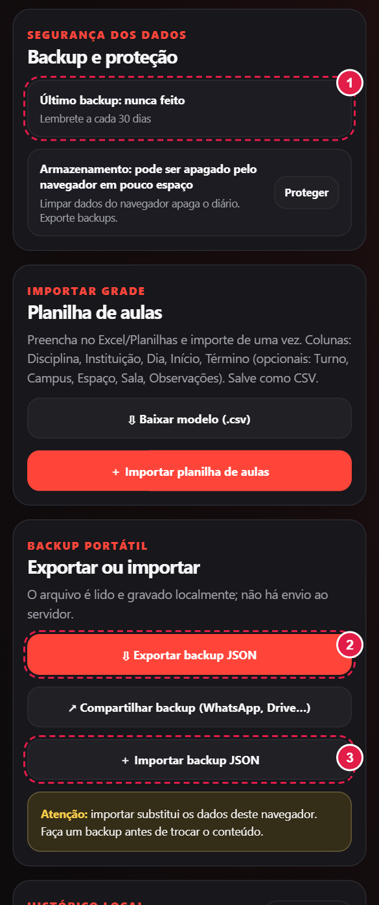</p>

1. **Último backup**: quando foi feito (e o lembrete de 30 dias).
2. **Exportar backup JSON**: baixa o arquivo `pontual_backup_<semestre>.json`, com grade, instituições, regras, histórico de ponto, **diário, plano de ensino e avaliações**.
3. **Importar backup JSON**: restaura um arquivo (**substitui** tudo o que está neste navegador).

### Compartilhar o backup
Se o seu navegador permite (em geral, no celular), aparece também **Compartilhar backup (WhatsApp, Drive…)**, logo abaixo de **Exportar**: o arquivo vai direto para o app que você escolher, sem precisar procurá-lo na pasta de downloads. Guarde-o em um lugar seguro (Google Drive, e-mail para você mesmo, pen drive).

### Quando fazer
Pelo menos uma vez por mês. O app mostra o cartão **“Seus dados só existem neste aparelho”** quando o último backup passa de 30 dias.

### Proteger o armazenamento
Em **Dados → Backup e proteção**, se aparecer **“pode ser apagado pelo navegador em pouco espaço”**, toque em **Proteger**. O navegador pode ou não conceder; mantenha os backups em dia de qualquer forma.

### Restaurar
**Dados → Importar backup JSON**, escolha o arquivo e confirme. Backups feitos em versões anteriores do Pontual continuam funcionando.

---

## 12. Trocar de aparelho

1. No aparelho antigo: **Dados → Exportar backup JSON** (ou **Compartilhar backup**).
2. Envie o arquivo para o aparelho novo (e-mail, Drive, WhatsApp, cabo…).
3. No aparelho novo: abra o Pontual → **Dados → Importar backup JSON** e escolha o arquivo.

Cada aparelho tem a sua própria cópia — **não há sincronização automática**. Se usar o app no celular e no computador, exporte e importe quando quiser alinhá-los.

**Vindo do aplicativo antigo (Expo)?** Exporte o JSON por lá e importe do mesmo jeito em **Dados → Importar backup JSON**.

---

## 13. Problemas comuns

| Problema | O que fazer |
|---|---|
| **O botão de ponto não abre o portal** | Verifique em **Ajustes → Instituições** se o link começa com `https://` e está certo. Permita pop-ups/novas abas para o site. Se aparecer “Configure o link de ponto”, falta cadastrar o link ou uma regra. |
| **A aula de hoje não aparece** | Confira o **Dia da semana** da aula e o **semestre ativo** (seletor no topo). |
| **A disciplina não aparece no Diário** | O diário lista disciplinas do **semestre ativo**. Cadastre a aula na Grade ou troque o semestre. |
| **Dois dias da mesma disciplina viraram diários separados** | O nome está escrito diferente (ex.: `Cálculo I` e `Calculo 1`). Padronize o nome em **Grade** (✎ na aula); o diário se junta quando a instituição e o nome coincidem. |
| **Numeração estranha** | Confira **Aulas no dia** e a **Situação** das linhas. Faltas e feriados não contam. As datas determinam a ordem. |
| **Um feriado não foi marcado** | Só os feriados **nacionais** são marcados automaticamente. Marque os estaduais/municipais e recessos à mão (✎ → Situação → Sem aula). |
| **O plano de ensino não aparece no formulário** | Cadastre os tópicos na aba **Plano de ensino** da mesma disciplina. |
| **Um tópico não conta como dado** | Só conta quando uma aula **Realizada** ou **Reposição** o inclui. Abra a aula (✎), marque o tópico e salve. |
| **O botão 🎙 não aparece** | Seu navegador não oferece reconhecimento de voz (use Chrome, Edge ou Safari recente). Se aparece e não funciona, permita o microfone para o site. |
| **Não recebo notificações** | Ative em **Ajustes → Lembretes e calendário**, permita no navegador, e no iPhone instale o app na tela inicial. Para garantir, use o **.ics**. |
| **O CSV abre tudo em uma coluna** | No Excel: **Dados → De Texto/CSV**, delimitador **Ponto e vírgula**. No Planilhas Google: **Arquivo → Importar**. |
| **Perdi os dados** | Importe o último backup em **Dados**. Sem backup não há como recuperar, porque nada é guardado em servidor. |
| **O app mostra versão antiga** | Feche e abra o app duas vezes (o navegador atualiza em segundo plano). No navegador, recarregue a página (Ctrl+F5 / puxar para atualizar). |
| **“Não foi possível abrir seus dados”** | Seu navegador pode estar em navegação privada ou bloqueando armazenamento. Use a janela normal e permita dados do site. |

---

## 14. Perguntas frequentes

**O Pontual bate o ponto por mim?**
Não. Ele abre o portal da sua instituição e registra no seu histórico que você foi lá (e, se confirmar, que concluiu).

**O Pontual é ligado à minha instituição?**
Não. É um app independente de organização pessoal. Ele não acessa nem envia nada aos sistemas da instituição.

**Meus dados vão para a internet?**
Não. Ficam no seu aparelho. O servidor só entrega o app. Os arquivos que você exporta ou importa (backup, CSV, planilha, calendário) são processados no próprio aparelho. A única exceção opcional é o **ditado por voz**, feito pelo reconhecimento de voz do navegador (veja o [aviso](#ditar-por-voz)).

**Funciona sem internet?**
Sim, depois de carregado uma vez. Abrir o portal de ponto, claro, exige internet.

**Posso usar no celular e no computador?**
Sim, mas cada um tem seus próprios dados. Use exportar/importar para alinhar.

**Guarda nomes ou notas de alunos?**
Não. O Pontual guarda o conteúdo das aulas, datas, plano de ensino e datas/média das avaliações. Não há lista de alunos, chamada nem notas individuais.

**Tem anúncio ou cadastro?**
Não há contas nem anúncios.

**Posso editar um registro antigo do diário?**
Sim, quando quiser: ✎ na linha, ajuste e salve; a numeração se corrige.

---

# Para quem mantém o código

Aplicativo Django que apenas **serve** uma PWA estática. Não há modelos, endpoints de gravação nem banco de dados persistente de dados pessoais no servidor.

## 15. Executar localmente

```powershell
py -m venv .venv
.\.venv\Scripts\Activate.ps1
pip install -r requirements.txt
python manage.py runserver
```

Abra `http://127.0.0.1:8000/`. O servidor de desenvolvimento é local e não deve ser exposto diretamente à internet.

## 16. Testes

```powershell
python manage.py check
python manage.py test
node --test tests_js/lib.test.js
```

- `python manage.py test`: verifica o shell da aplicação (páginas, diálogos, manifest, service worker, arquivos estáticos).
- `node --test tests_js/lib.test.js`: cobre as funções puras de `static/core/lib.js` — numeração do diário, CSV/TSV, calendário `.ics`, conflitos de horário, lembretes, feriados nacionais (incluindo a Páscoa), plano de ensino, avaliações e importação de planilha. Requer Node.js 18 ou mais novo.

## 17. Publicar na Vercel

O projeto já inclui `vercel.json` (`"framework": "python"`) e `app.py`, que expõe o WSGI do Django. Basta conectar o repositório ao projeto Vercel; cada push em `main` publica.

Variáveis de ambiente opcionais (Settings → Environment Variables):

| Variável | Efeito |
|---|---|
| `DJANGO_SECRET_KEY` | Chave secreta do Django. **Defina uma própria em produção.** |
| `DJANGO_DEBUG` | `1` liga o modo debug (na Vercel o padrão é desligado). |
| `DJANGO_ALLOWED_HOSTS` | Domínios extras (separados por vírgula), além de `.vercel.app`. |

Os arquivos estáticos são servidos com WhiteNoise direto da pasta `static/`, sem `collectstatic`.

> Ao alterar `app.css`, `app.js` ou `lib.js`, aumente a versão `?v=N` no `templates/core/index.html` e em `static/core/service-worker.js` (e o `CACHE_NAME`, e o teste em `core/tests.py`), para os usuários receberem a atualização.

## 18. Estrutura do projeto

```text
core/                 views (home, manifest, service worker) e testes Django
pontual/              configurações do projeto Django
templates/core/       index.html (shell, diálogos e navegação)
static/core/
  app.js              interface e estado (IndexedDB)
  lib.js              funções puras testáveis (sem DOM)
  app.css             estilos responsivos (mobile primeiro)
  service-worker.js   cache offline e cliques em notificações
  manifest.webmanifest  PWA e atalhos (Ponto, Diário, Grade)
tests_js/             testes Node das funções puras
docs/img/             prints usados neste README (dados fictícios)
app.py, vercel.json   entrada e configuração da Vercel
```

Modelo de dados (um único documento no IndexedDB do navegador): `activeSemester`, `semesters`, `userProfile`, `institutions`, `pontoRules`, `classes`, `pontoLogs`, `diary`, `syllabus`, `assessments` e `settings`. O backup JSON é exatamente esse documento; campos ausentes em backups antigos recebem valores padrão ao importar.
